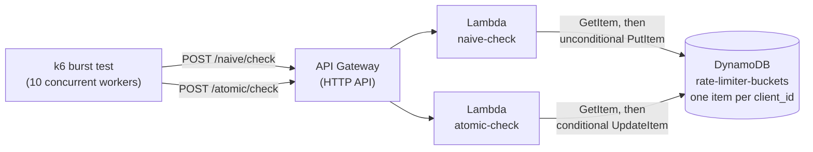

# Distributed Rate Limiter (Token Bucket on DynamoDB)

A per-client token-bucket rate limiter behind API Gateway and Lambda, with bucket state in DynamoDB. Two implementations of the same check are deployed side by side: one uses a non-atomic read-check-write sequence, the other a conditional write. Load-testing a 100-request burst against a 10-token bucket, the non-atomic version admitted 37 requests; the conditional-write version admitted 11 (capacity plus one token refilled during the burst).

## Architecture



One DynamoDB item per client holds `tokens` and `last_refill_timestamp`. Refill is lazy: each request computes the tokens accrued since the last write (`elapsed × refill_rate`, capped at capacity), so there is no background refill job. A missing item is treated as a full bucket, which makes reset a single `DeleteItem`.

Both implementations are built from the same code package (`src/handler.py`) as two Lambda functions behind two routes, so they can be tested under identical conditions. All infrastructure is Terraform (`terraform/`); the two paths are generated from a single `{naive, atomic}` map.

## The race condition and the fix

The naive implementation:

1. `GetItem` — read the bucket, apply lazy refill in application code
2. Check `tokens >= cost` in application code
3. `PutItem` — write back the decremented count

Steps 1–3 are not atomic. Two concurrent requests can interleave:

```
Request A                      Request B
─────────                      ─────────
GetItem  → tokens = 1
                               GetItem  → tokens = 1
1 ≥ 1 → admit
                               1 ≥ 1 → admit
PutItem tokens = 0
                               PutItem tokens = 0     ← double spend
```

Both requests observed the same token, both passed the check, and the second write overwrote the first. This is a time-of-check-to-time-of-use (TOCTOU) race. It cannot be fixed in application code: the gap between the read and the write is two network round-trips, and any number of requests can interleave inside it.

The atomic implementation makes the write verify the state it was based on — a compare-and-set. The write is a conditional `UpdateItem`:

```
UpdateExpression:    SET tokens = :new_tokens, last_refill_timestamp = :now
ConditionExpression: tokens = :seen_tokens AND last_refill_timestamp = :seen_ts
```

DynamoDB evaluates the condition and applies the write as one atomic operation, serialized per item. The update succeeds only if the bucket is still exactly the state the admission decision was computed from. Every admission changes `tokens`, so if another request was admitted between the read and the write, the condition fails with `ConditionalCheckFailedException` instead of double-spending. The losing request re-reads and retries, bounded at 10 attempts, then fails closed with a 429 (denying a request that might have been admissible is safe; over-admitting is not).

If the bucket never refilled, a simpler one-shot form would suffice: `ConditionExpression: tokens >= :cost` with `SET tokens = tokens - :cost`, no retry loop. Lazy refill is what forces the full compare-and-set: the new token count is computed client-side from `last_refill_timestamp`, so the condition must assert both fields are unchanged — otherwise two requests could each apply the same refill.

The consequence: admission decisions on a bucket serialize. Concurrency no longer causes over-admission; it causes retries, which show up as tail latency. Both effects are visible in the measurements.

## Results

100 requests per endpoint (10 concurrent workers × 10 requests each) against a single `client_id`, bucket capacity 10, refill 1 token/sec. Raw k6 output is committed under [`load-test/results/`](load-test/results/). Every response was a 200 or 429; no errors or throttles.

| Endpoint | Requests sent | Admitted | Bucket capacity | med | p95 | p99 |
|---|---|---|---|---|---|---|
| `/naive/check` | 100 | 37 | 10 | 103 ms | 134 ms | 142 ms |
| `/atomic/check` | 100 | 11 | 10 | 101 ms | 382 ms | 536 ms |

- The naive endpoint admitted 3.7× its budget. Each excess admission is a lost race between one request's read and another's write.
- The atomic endpoint admitted 11: capacity 10 plus ~1 token refilled during the ~1.5 s burst window. This is the correct count, and it cannot exceed capacity + refill at any concurrency level.
- Median latency is essentially equal (~100 ms, dominated by API Gateway + Lambda + one DynamoDB round-trip). The atomic path has a longer tail (p99 536 ms vs 142 ms) because contended requests spend CAS retries, each a fresh read plus conditional write. For a rate limiter this is an acceptable trade: contention on one bucket means that client is at its limit.
- Test shape: this account (AWS free plan) caps Lambda at 10 concurrent executions, so the burst uses 10 workers × 10 sequential requests rather than 100 simultaneous ones. An earlier 100-VU run had ~90% of requests throttled by Lambda into 500s, which made results unusable. Ten concurrent workers were sufficient to reproduce the race.

## Running it

Prerequisites: Terraform ≥ 1.5, AWS CLI with configured credentials, k6, Python 3.

```bash
# 1. Deploy. Outputs the endpoint URLs.
terraform -chdir=terraform apply

# 2. Send a request
BASE=$(terraform -chdir=terraform output -raw api_endpoint)
curl -X POST "$BASE/atomic/check?client_id=me&cost=1"
# → {"allowed": true, "remaining": 9}

# 3. Reset a client's bucket to full
./scripts/reset.sh me

# 4. Run the comparison load test: warms up both endpoints, resets the
#    test bucket, bursts each, saves raw output to load-test/results/
./load-test/run.sh

# 5. Tear down
terraform -chdir=terraform destroy
```

Bucket capacity and refill rate are Terraform variables (`bucket_capacity`, `refill_rate_per_second`) passed to the Lambdas as environment variables.

## Cost

No resource here bills by the hour; an idle deployment costs nothing.

- Lambda: inside the always-free tier (1M requests/month).
- DynamoDB: on-demand billing, ~$1.50 per million request-units — fractions of a cent at load-test volume. On-demand was chosen over always-free provisioned capacity because 5 provisioned WCU would throttle the burst and mix throttling errors into the results. Storage is a few KB.
- API Gateway: $1.00 per million requests after the first free year.
- CloudWatch Logs: 7-day retention, inside the free 5 GB/month ingestion.

## Limitations and next steps

- CAS retries have no backoff; under contention losers retry immediately and can collide again. Exponential backoff with jitter should reduce the p99 tail.
- The refill function is pure but only covered by end-to-end tests; it should have unit tests.
- The Lambda concurrency quota (10 on this account) limits the test to 10 truly simultaneous requests. With a quota increase the burst could run at 100+ VUs as originally designed.
- Token bucket is the only algorithm implemented. A sliding-window counter alongside it would allow a concrete comparison of burst tolerance, precision, and storage cost.
- No metrics beyond k6 output; a CloudWatch dashboard of admit/deny rates per endpoint would show behavior over time.
