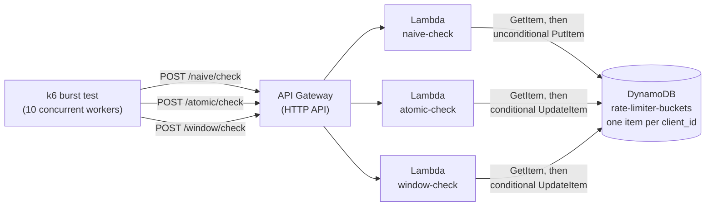

# Distributed Rate Limiter (DynamoDB)

A per-client rate limiter behind API Gateway and Lambda, with state in DynamoDB. Three implementations of the same check are deployed side by side: a token bucket with a non-atomic read-check-write sequence, a token bucket with an atomic conditional write, and a sliding-window counter. Load-testing a 100-request burst against a limit of 10, the non-atomic version admitted 35 requests; the conditional-write version admitted 11 (capacity plus one token refilled during the burst); the sliding window admitted exactly 10.

## Architecture



Token bucket state is one item per client: `tokens` and `last_refill_timestamp`. Refill is lazy — each request computes the tokens accrued since the last write (`elapsed × refill_rate`, capped at capacity), so there is no background refill job. Sliding-window state is a separate item per client (`window#<client_id>`): the current fixed window's start and count plus the previous window's count. A missing item is treated as a fresh limit, which makes reset a single `DeleteItem`.

All three implementations are built from the same code package (`src/handler.py`; pure math in `src/algorithms.py`) as three Lambda functions behind three routes, so they can be tested under identical conditions. All infrastructure is Terraform (`terraform/`); the three paths are generated from a single map.

## The race condition and the fix

The non-atomic implementation (`/naive/check`):

1. `GetItem` — read the bucket, apply lazy refill in application code
2. Check `tokens >= cost` in application code
3. `PutItem` — write back the decremented count

Steps 1–3 are not atomic. Two concurrent requests can interleave:

```
Request A                      Request B
─────────                      ─────────
GetItem  → tokens = 1
                               GetItem  → tokens = 1
1 ≥ 1 → admit
                               1 ≥ 1 → admit
PutItem tokens = 0
                               PutItem tokens = 0     ← double spend
```

Both requests observed the same token, both passed the check, and the second write overwrote the first. This is a time-of-check-to-time-of-use (TOCTOU) race. It cannot be fixed in application code: the gap between the read and the write is two network round-trips, and any number of requests can interleave inside it.

The atomic implementation makes the write verify the state it was based on — a compare-and-set. The write is a conditional `UpdateItem`:

```
UpdateExpression:    SET tokens = :new_tokens, last_refill_timestamp = :now
ConditionExpression: tokens = :seen_tokens AND last_refill_timestamp = :seen_ts
```

DynamoDB evaluates the condition and applies the write as one atomic operation, serialized per item. The update succeeds only if the bucket is still exactly the state the admission decision was computed from. Every admission changes `tokens`, so if another request was admitted between the read and the write, the condition fails with `ConditionalCheckFailedException` instead of double-spending. The losing request backs off (exponential with full jitter, 0–20 ms doubling per attempt, capped at 200 ms), re-reads, and retries, bounded at 10 attempts, then fails closed with a 429 (denying a request that might have been admissible is safe; over-admitting is not).

If the bucket never refilled, a simpler one-shot form would suffice: `ConditionExpression: tokens >= :cost` with `SET tokens = tokens - :cost`, no retry loop. Lazy refill is what forces the full compare-and-set: the new token count is computed client-side from `last_refill_timestamp`, so the condition must assert both fields are unchanged — otherwise two requests could each apply the same refill.

The consequence: admission decisions on a bucket serialize. Concurrency no longer causes over-admission; it causes retries, which show up as tail latency. Both effects are visible in the measurements. Each atomic response includes a `retries` field so the load test can record the retry distribution.

## Sliding window counter

`/window/check` enforces the same steady rate (10 requests per 10 s) with a different algorithm. Two counters per client — the current fixed window's count and the previous window's — are combined into a sliding estimate: the previous count weighted by how much of that window still overlaps the trailing 10 seconds, plus the current count. The estimate assumes requests in the previous window were uniformly distributed, which is the algorithm's precision trade-off.

Concurrency control is the same compare-and-set: the conditional write asserts all three stored fields are unchanged since the read. The interesting difference is burst behavior:

| | Token bucket | Sliding window counter | Fixed window counter |
|---|---|---|---|
| Burst tolerance | Allows a full-capacity burst any time the bucket is full; refill readmits during sustained load | Smooths bursts across window boundaries; no readmission until time passes | Allows up to 2× the limit straddling a window boundary |
| Storage per client | 2 numbers | 3 numbers | 2 numbers |
| Precision | Exact for its policy | Approximate (uniform-distribution assumption) | Exact within a window, wrong at boundaries |

## Results

100 requests per endpoint (10 concurrent workers × 10 requests each) against a single `client_id`, limit 10 (bucket capacity 10 with refill 1 token/sec; window limit 10 per 10 s). Raw k6 output is committed under [`load-test/results/`](load-test/results/). Every response was a 200 or 429; no errors or throttles.

| Endpoint | Requests sent | Admitted | Limit | med | p95 | p99 |
|---|---|---|---|---|---|---|
| `/naive/check` | 100 | 35 | 10 | 111 ms | 152 ms | 163 ms |
| `/atomic/check` | 100 | 11 | 10 | 106 ms | 310 ms | 375 ms |
| `/window/check` | 100 | 10 | 10 | 107 ms | 258 ms | 386 ms |

- The non-atomic endpoint admitted 3.5× its budget. Each excess admission is a lost race between one request's read and another's write.
- The atomic endpoint admitted 11: capacity 10 plus ~1 token refilled during the ~1.5 s burst. This is the correct count for its policy and cannot exceed capacity + refill at any concurrency level.
- The window endpoint admitted exactly 10: window counts do not decay mid-burst, so nothing is readmitted until the window slides. Same steady rate as the token bucket, stricter burst behavior.
- Median latency is essentially equal across all three (~110 ms, dominated by API Gateway + Lambda + one DynamoDB round-trip). The two atomic paths have longer tails (p99 ~380 ms vs 163 ms) because contended requests spend CAS retries, each a fresh read plus conditional write. For a rate limiter this is an acceptable trade: contention on one key means that client is at its limit.
- Test shape: this account (AWS free plan) caps Lambda at 10 concurrent executions, so the burst uses 10 workers × 10 sequential requests rather than 100 simultaneous ones. An earlier 100-VU run had ~90% of requests throttled by Lambda into 500s, which made results unusable. Ten concurrent workers were sufficient to reproduce the race.

### CAS retry backoff

Retrying immediately after a lost CAS risks colliding again. Backoff is configurable (`cas_backoff` Terraform variable: `none` or `jitter`); the same atomic burst was run under both:

| Backoff | Retries avg | Retries p95 | Retries max | med | p95 | p99 |
|---|---|---|---|---|---|---|
| none | 0.35 | 3 | 5 | 110 ms | 317 ms | 416 ms |
| jitter | 0.25 | 2 | 4 | 119 ms | 256 ms | 420 ms |

At this contention level (10 workers, one key) jitter measurably reduces retries and p95 latency, while p99 is unchanged within run-to-run noise — the worst request still pays for several round-trips. The effect should grow with concurrency; see next steps. Raw output: `results/atomic-backoff-{none,jitter}-*`.

## Running it

Prerequisites: Terraform ≥ 1.5, AWS CLI with configured credentials, k6, Python 3.

```bash
# Unit tests (pure algorithm math)
pip install pytest && pytest

# 1. Deploy. Outputs the endpoint URLs.
terraform -chdir=terraform apply

# 2. Send a request
BASE=$(terraform -chdir=terraform output -raw api_endpoint)
curl -X POST "$BASE/atomic/check?client_id=me&cost=1"
# → {"allowed": true, "remaining": 9, "retries": 0}

# 3. Reset a client's limits
./scripts/reset.sh me

# 4. Run the comparison load test: warms up each endpoint, resets the
#    test client, bursts each, saves raw output to load-test/results/
./load-test/run.sh

# 5. Tear down
terraform -chdir=terraform destroy
```

Limits are Terraform variables (`bucket_capacity`, `refill_rate_per_second`, `window_seconds`, `cas_backoff`) passed to the Lambdas as environment variables. CI (GitHub Actions) runs `terraform fmt`/`validate` and the unit tests on every push.

## Cost

No resource here bills by the hour; an idle deployment costs nothing.

- Lambda: inside the always-free tier (1M requests/month).
- DynamoDB: on-demand billing, ~$1.50 per million request-units — fractions of a cent at load-test volume. On-demand was chosen over always-free provisioned capacity because 5 provisioned WCU would throttle the burst and mix throttling errors into the results. Storage is a few KB.
- API Gateway: $1.00 per million requests after the first free year.
- CloudWatch Logs: 7-day retention, inside the free 5 GB/month ingestion.

## Limitations and next steps

- The Lambda concurrency quota (10 on this account) limits the test to 10 truly simultaneous requests. With a quota increase, the burst could run at 100+ VUs and produce an over-admission-vs-concurrency curve; the backoff comparison would also be more pronounced.
- Failure mode is implicit: a DynamoDB error currently surfaces as a 500. A deliberate fail-open/fail-closed policy (and a test that induces the failure) would make the availability-vs-correctness trade explicit.
- No metrics beyond k6 output; a CloudWatch dashboard of admit/deny/retry rates per endpoint would show behavior over time.
