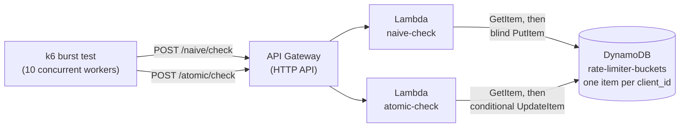

# Distributed Rate Limiter — a race condition, measured

A token-bucket rate limiter on API Gateway + Lambda + DynamoDB, implemented twice: once with a naive read-then-write check, once with an atomic conditional write. Under a 100-request burst against a 10-token bucket, **the naive version admitted 37 requests; the atomic version admitted 11**. This repo exists to demonstrate — with real load-test numbers, not hand-waving — why the naive approach breaks under concurrency and exactly how the fix works.

## Architecture



One DynamoDB item per client holds the bucket state: `tokens` and `last_refill_timestamp`. Refill is lazy — each request computes how many tokens have accrued since the last write (`elapsed × refill_rate`, capped at capacity), so there is no background refill job and a client that never sends requests costs nothing. A missing item means a full bucket, which makes "reset" simply `DeleteItem`.

Both implementations are deployed side by side from the same code package (`src/handler.py`), as two Lambda functions behind two routes, so they can be load-tested under identical conditions. Everything is Terraform (`terraform/`), fanned out from a single `{naive, atomic}` map so the two paths are structurally identical infrastructure.

## The core concept: a read-then-write race, and the conditional write that fixes it

**The naive implementation** does what looks reasonable in a single-threaded world:

1. `GetItem` — read the bucket, apply lazy refill in application code
2. Check `tokens >= cost` in application code
3. `PutItem` — write back the decremented count

The bug is that steps 1–3 are not atomic. Two concurrent requests interleave like this:

```
Request A                      Request B
─────────                      ─────────
GetItem  → tokens = 1
                               GetItem  → tokens = 1
1 ≥ 1 → admit
                               1 ≥ 1 → admit
PutItem tokens = 0
                               PutItem tokens = 0     ← double spend
```

Both requests observed the same token, both passed the check, and the second blind write silently overwrote the first. One token admitted two requests — and under a burst of N concurrent requests, every interleaving admits another freeloader. This is a classic *time-of-check-to-time-of-use* (TOCTOU) race: the state the decision was based on is stale by the time the decision is written back. No amount of application-side care fixes it, because the gap between read and write is physical (two network round-trips), not logical.

**The atomic implementation** closes the gap by making the write itself verify the premise it was based on — a compare-and-set. The write is a conditional `UpdateItem`:

```
UpdateExpression:    SET tokens = :new_tokens, last_refill_timestamp = :now
ConditionExpression: tokens = :seen_tokens AND last_refill_timestamp = :seen_ts
```

DynamoDB evaluates the condition and applies the write as one atomic operation, serialized per item. So the update means: *"decrement the bucket — but only if it is still exactly the state my admission decision was computed from."* Every admission changes `tokens`, so if any other request was admitted between our read and our write — even in the same millisecond — our condition fails with `ConditionalCheckFailedException` instead of double-spending. The loser re-reads the fresh state and retries (bounded at 10 attempts, then fails closed with a 429: denying a request we might have admitted is safe; over-admitting is not).

A note on the simpler form: if the bucket never refilled, `ConditionExpression: tokens >= :cost` with `SET tokens = tokens - :cost` would suffice — the check and decrement in one server-side operation, no retry loop. Lazy refill is what forces the full compare-and-set: the new token count is computed client-side from `last_refill_timestamp`, so the condition must assert that *both* fields are unchanged, otherwise two requests could each add the same refill twice.

The effect: admission decisions on one bucket **serialize**. Concurrency no longer creates correctness bugs — it only creates retries, which cost tail latency. That tradeoff is visible in the measurements below.

## Measured results

100 requests per endpoint (10 concurrent workers × 10 requests each) against a single `client_id` with bucket capacity **10**, refill **1 token/sec**. Raw k6 output is committed under [`load-test/results/`](load-test/results/); every response was a clean 200 or 429 (no throttles or errors).

| Endpoint | Requests sent | Admitted | Bucket capacity | med | p95 | p99 |
|---|---|---|---|---|---|---|
| `/naive/check` | 100 | **37** | 10 | 103 ms | 134 ms | 142 ms |
| `/atomic/check` | 100 | **11** | 10 | 101 ms | 382 ms | 536 ms |

**Interpretation:**

- The naive endpoint over-admitted by **3.7×** — 37 requests spent 10 tokens' worth of budget (plus ~1 refill token). Each over-admission is a lost race that a correct limiter would have denied.
- The atomic endpoint admitted **11 = 10 (capacity) + ~1 token refilled** during the ~1.5 s burst window. That is exactly the correct number; it cannot exceed capacity + refill regardless of concurrency.
- Median latency is identical (~100 ms — dominated by API Gateway + Lambda + one DynamoDB round-trip). The atomic version pays for correctness in the **tail**: p99 of 536 ms vs 142 ms, because contended requests burn CAS retries (each retry is a fresh read + conditional write). This is the honest cost of serializing a hot key — acceptable for a rate limiter, where contention means the client is over their limit anyway.
- Test shape note: this account (AWS free plan) caps Lambda at **10 concurrent executions**, so the burst uses 10 workers × 10 sequential requests rather than 100 simultaneous ones. Even 10 truly concurrent racers were enough to over-admit 3.7× — the race needs only two requests to interleave.

## How to run

Prerequisites: Terraform ≥ 1.5, AWS CLI (configured credentials), k6, Python 3.

```bash
# 1. Deploy (~30s). Outputs the endpoint URLs.
terraform -chdir=terraform apply

# 2. Poke it manually
BASE=$(terraform -chdir=terraform output -raw api_endpoint)
curl -X POST "$BASE/atomic/check?client_id=me&cost=1"
# → {"allowed": true, "remaining": 9}

# 3. Reset a client's bucket to full
./scripts/reset.sh me

# 4. Run the comparison load test (warms up, resets, bursts both endpoints,
#    saves raw output to load-test/results/, prints the verdict)
./load-test/run.sh

# 5. Tear everything down — no manual cleanup needed
terraform -chdir=terraform destroy
```

Bucket capacity and refill rate are Terraform variables (`bucket_capacity`, `refill_rate_per_second`) passed to the Lambdas as environment variables.

## Cost

Effectively $0. Nothing here bills by the hour — an idle deployed stack costs nothing, and `terraform destroy` is tidiness, not bill-stopping.

- **Lambda**: within the always-free tier (1M requests/month).
- **DynamoDB**: on-demand billing, ~$1.50 per million request-units — fractions of a cent at load-test volumes. On-demand is a deliberate choice over always-free provisioned capacity: 5 provisioned WCU would throttle the burst and pollute the race-condition results with throttling errors. Storage (a few KB) is far inside the free 25 GB.
- **API Gateway**: $1.00 per million requests after the first free year — the largest "real" cost, about a dime per million-request year of testing.
- **CloudWatch Logs**: 7-day retention, well inside the free 5 GB/month ingestion.

## What I'd do differently / next steps

- **Raise the Lambda concurrency quota** and rerun at 100+ simultaneous requests — the free-plan cap of 10 was discovered the hard way (90% of the first run came back as Lambda throttles) and shaped the test design.
- **Add jitter to CAS retries.** Under contention all losers retry immediately and can collide again; small randomized backoff would flatten the p99 tail.
- **Unit-test the refill math.** The lazy-refill function is pure and trivially testable; the project currently relies on end-to-end verification only.
- **Sliding-window comparison** (stretch goal): implement a sliding-window counter alongside token bucket and compare burst tolerance vs. precision vs. storage cost.
- **Metrics**: a small CloudWatch dashboard of admit/deny rates per endpoint would make demos nicer than reading k6 output.
